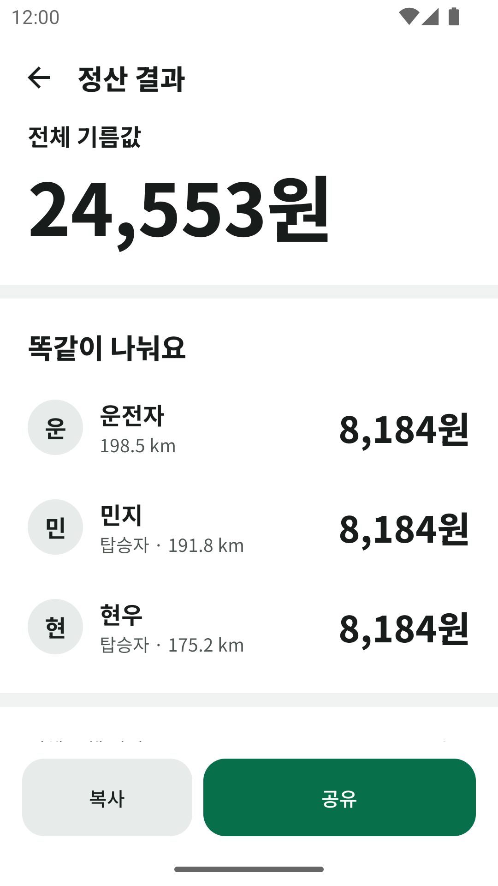
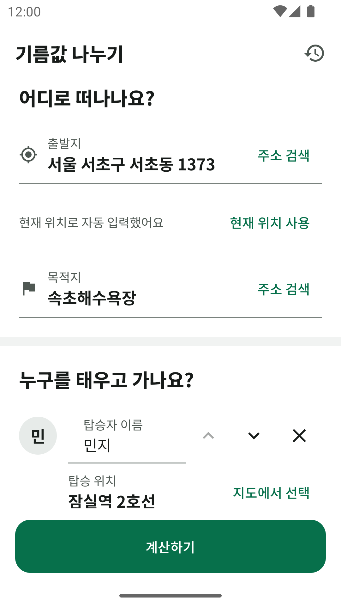
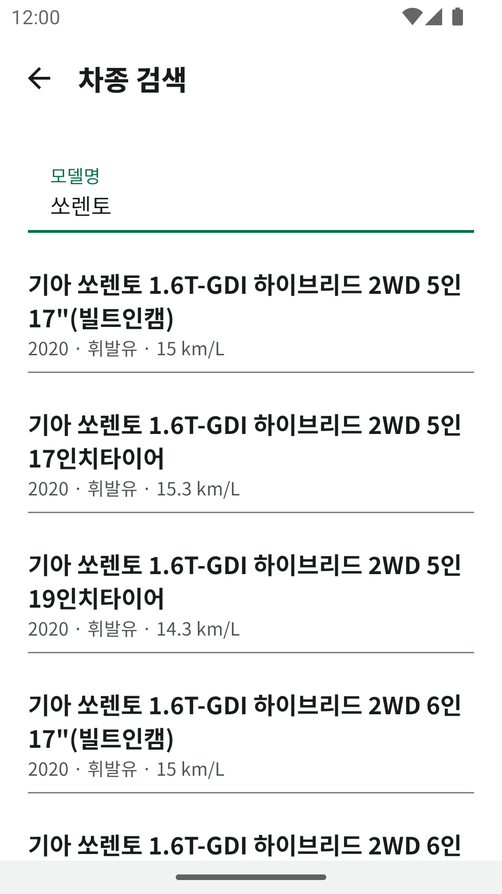
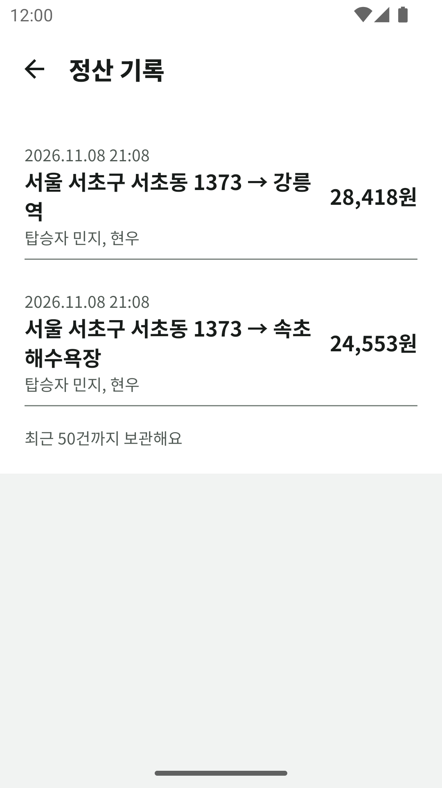

# 기름값 나누기 (SharingFuelCost)

친구들과 차 한 대로 이동할 때 드는 기름값을 계산하고, 누가 얼마를 내면 되는지 정산해 주는 Android 앱입니다.
출발지, 탑승 위치, 목적지를 고르면 실제 도로 경로로 거리를 조회하고, 차종의 표시연비와 오늘의 평균 유가로 전체 기름값을 구한 뒤 참여자별 부담금을 보여 줍니다.

- 상태: Google Play 비공개 테스트 중 (1.1, versionCode 4)
- 플랫폼: Android 9(API 28) 이상

| 정산 결과 | 입력 | 차종 검색 | 정산 기록 |
|---|---|---|---|
|  |  |  |  |

## 주요 기능

- **실제 주행 거리 조회**: 카카오모빌리티 자동차 길찾기 API로 출발지 → 탑승 위치(최대 5곳) → 목적지 경로의 전체 거리와 탑승자별 이동 거리를 구합니다.
- **위치 입력**: 주소·장소 검색, 지도에서 고르기, 현재 위치(출발지를 정할 때 한 번만 조회).
- **두 가지 정산 방식**
  - 균등 분할: 전체 기름값을 참여 인원수로 나눕니다.
  - 이동 거리 비례 분할: 탑승자는 자기가 탄 거리만큼 내고, 운전자는 나머지를 냅니다.
- **차종 검색과 표시연비**: 한국에너지공단 표시연비 데이터에서 차종을 찾아 연비를 채웁니다. 타이어 크기, 인승처럼 사소한 차이만 있는 트림은 한 줄로 묶고 평균 연비를 보여 줍니다.
- **전기차와 플러그인 하이브리드**: 전기차는 전비(km/kWh)와 충전비(원/kWh)로 계산합니다. 플러그인 하이브리드는 전기와 휘발유 중에서 고릅니다.
- **평균 유가 자동 입력**: 오피넷 전국 평균가를 하루 한 번 받아 연료에 맞게 채웁니다.
- **내 차 저장, 정산 기록**: 자주 타는 차를 저장하고, 최근 50건의 정산 결과를 다시 보거나 공유합니다.
- **결과 공유**: 정산 결과를 텍스트로 복사하거나 메신저로 공유합니다.
- **인앱 즉시 업데이트**: 새 버전이 있으면 앱을 열 때 업데이트 화면을 띄웁니다.
- 외부 API가 실패해도 거리, 연비, 유가를 직접 입력해 끝까지 계산할 수 있습니다.

## 정산 규칙

```
연료 사용량(L) = 주행 거리(km) / 연비(km/L)
전체 기름값(원) = 연료 사용량(L) × 유가(원/L)   → 1원 단위 반올림
```

| 방식 | 부담금 |
|---|---|
| 균등 분할 | `내림(전체 기름값 / 참여 인원수)`. 1원 미만 잔액은 누구에게도 배정하지 않음 |
| 이동 거리 비례 분할 | 탑승자: `내림(전체 기름값 × 탑승자 이동 거리 / 전체 주행 거리)`, 운전자: 나머지 |

예) 연비 10km/L, 유가 1,600원/L, 출발지 → A 탑승 10km → B 탑승 5km → 목적지 20km

| 방식 | 운전자 | A | B | 합계 |
|---|---|---|---|---|
| 균등 분할 | 1,866원 | 1,866원 | 1,866원 | 5,598원 |
| 거리 비례 분할 | 1원 | 3,111원 | 2,488원 | 5,600원 |

금액은 `Double`을 누적하지 않고, 전체 기름값을 정수(원)로 확정한 뒤 정수 연산으로 나눕니다. "거리 비례 합계 = 전체 기름값", "부담금은 음수가 아님" 같은 불변 조건을 단위 테스트로 검증합니다. 자세한 규칙은 [`docs/settlement-rules.md`](docs/settlement-rules.md)에 있습니다.

## 아키텍처

멀티모듈 클린 아키텍처에 MVI 스타일의 단방향 상태 관리를 씁니다.

```
app ──────────▶ presentation ──▶ domain
 │                                  ▲
 └────────────▶ data ───────────────┘
```

| 모듈 | 역할 |
|---|---|
| `domain` | 순수 Kotlin. 정산 계산기, 차량·유가·경로 모델, 저장소 인터페이스. Android 의존성 없음 |
| `data` | Retrofit 기반 API 구현(카카오, 오피넷, 공공데이터), 응답 → 도메인 모델 변환, SharedPreferences 저장소 |
| `presentation` | Compose 화면, `FuelCostViewModel`(Intent → State), 테마 |
| `app` | Hilt DI 구성, Firebase App Check, 인앱 업데이트 |
| `build-logic` | SDK·Java 버전 등 공통 Gradle 설정을 convention plugin으로 관리 |
| `relay` | API 키를 숨기는 Cloudflare Workers 중계 서버 (JavaScript) |

- 외부 API 실패는 예외로 올리지 않고 `LookupResult.Failure(NETWORK / UNAUTHORIZED / QUOTA_EXCEEDED / NOT_CONFIGURED …)`로 바꿔 화면이 직접 입력으로 넘어가게 합니다.
- `presentation`은 `data`를 모르고, 둘을 연결하는 곳은 `app`의 DI뿐입니다.

## 기술 스택

| 분류 | 사용 기술 |
|---|---|
| 언어, 빌드 | Kotlin 2.2, Gradle Kotlin DSL, AGP 9.2, Version Catalog, convention plugin |
| UI | Jetpack Compose (Material 3), 라이트·다크 테마 |
| 비동기, DI | Coroutines, Flow, Hilt |
| 네트워크 | Retrofit 3, OkHttp 5, kotlinx.serialization |
| 지도 | Kakao Map SDK v2 |
| 보안 | Firebase App Check (release: Play Integrity), Cloudflare Workers 중계 서버 |
| 배포 | Google Play App Signing, Play In-App Updates, R8 |
| 테스트 | JUnit 4, kotlinx-coroutines-test, Node 테스트 러너(중계 서버) |

minSdk 28, targetSdk 36, compileSdk 37

## 기술적으로 고민한 점

### 1. 앱에 API 키를 넣지 않기: 중계 서버 + App Check

카카오 REST, 오피넷, 공공데이터 키를 APK에 넣으면 디컴파일로 추출될 수 있습니다. 그래서 키를 Cloudflare Workers 중계 서버의 비밀값으로만 두었습니다.

```
앱 ── X-Firebase-AppCheck 토큰 ──▶ relay (Cloudflare Workers) ── API 키 ──▶ 카카오 / 오피넷 / 공공데이터
```

- 앱은 키 대신 Firebase App Check 토큰을 보냅니다. release는 Play Integrity, debug는 디버그 토큰을 씁니다.
- 중계 서버는 외부 라이브러리 없이 WebCrypto로 JWT를 검증합니다. RS256 서명, `iss`, `aud`, `exp`, 앱 ID를 확인하고, 공개 키(JWKS)는 6시간 캐시합니다.
- 허용한 GET 경로만 통과시키고, 앱이 보낸 키 파라미터는 지운 뒤 서버의 키만 붙입니다. 원래 서버의 상태 코드는 그대로 돌려줘서 앱이 인증·쿼터·형식 오류를 구분할 수 있습니다.

### 2. 탑승자별 이동 거리 계산

카카오 자동차 길찾기 API에 탑승 위치를 경유지로 넣고, 응답의 구간 거리 `sections[].distance`를 이어 붙여 "그 탑승자가 탄 지점부터 목적지까지"의 거리를 구합니다. 구간 수가 경유지 수 + 1이 아니면 잘못된 응답으로 보고 직접 입력으로 넘깁니다. SDK의 내비 모듈은 카카오내비 앱을 실행할 뿐 거리를 돌려주지 않는다는 점을 공식 문서로 먼저 확인하고 REST API를 골랐습니다.

### 3. 공공데이터의 빈틈 메우기

표시연비 API(`CAREFF_LIST`)를 실제로 호출하면서 문서에 없는 문제를 여럿 찾아 해결했습니다.

| 문제 | 해결 |
|---|---|
| 2025년 이후 출시 차가 없음 (EV5 검색 0건) | 한국에너지공단의 다른 데이터셋(odcloud)을 같은 검색어로 동시에 조회해, 연료를 확실히 알 수 있는 전기차·PHEV만 결과에 붙임 |
| PHEV는 휘발유 연비만 있고 전비가 없음 | odcloud의 `복합_연비`("2.7 / 7.4" = 전비 / 연비)에서 전비를 읽어 모델명으로 짝지음. 두 API의 모델명은 띄어쓰기가 달라 공백을 빼고 비교 |
| 같은 차가 타이어 크기·인승·연식 표기만 다른 트림으로 수십 줄 | `15인치 타이어`, `(16“타이어)`, `14"`, `(22MY)`, `7인승` 등 제각각인 표기를 정규식으로 지우고, 모델명·년식·연료가 같은 트림을 묶어 평균 연비 표시 (쏘렌토 176줄 → 27줄) |
| 하이브리드의 연료명이 "휘발유" | `CAR_TYPE`을 함께 보고 "휘발유(하이브리드)"로 구분해 일반 휘발유 차와 평균이 섞이지 않게 함 |
| 요청 크기와 상관없이 한 번에 100건만 반환 | 첫 응답의 `totalCount`로 나머지 페이지를 동시에 받음 (최대 10페이지) |

오피넷도 문서에는 인증 파라미터가 `certkey`라고 되어 있지만 실제로는 `code`만 동작하고, 잘못된 키에도 HTTP 200과 빈 목록을 돌려줍니다. 그래서 빈 목록을 실패로 처리합니다.

### 4. Play 출시 과정의 문제 해결

비공개 테스트에서 주소 검색과 지도가 동작하지 않는 문제를 로그(`wrangler tail`)로 추적해 해결했습니다.

- 주소 검색 "인증 실패": Play Console에서 Play Integrity API와 Cloud 프로젝트를 연결하지 않아 App Check 토큰이 발급되지 않았습니다.
- 지도 "불러오지 못함": Play App Signing은 Play가 앱 서명 키로 다시 서명합니다. 그래서 카카오 키 해시는 업로드 키가 아니라 **앱 서명 키**의 SHA-1로 등록해야 했습니다. Base64 끝의 `=`도 빠지면 안 됩니다.

## 테스트

```bash
./gradlew test          # Android 모듈 단위 테스트 (250개)
cd relay && npm test    # 중계 서버 테스트
```

- `domain`: 정산 계산식, 반올림 경계, 균등·거리 비례 분할의 불변 조건, 잘못된 입력
- `data`: 실제 API 응답 형태의 JSON 파싱, 실패 구분, 트림 묶기, 페이지 조회, 저장 형식의 구버전 호환
- `presentation`: ViewModel의 성공·실패·직접 입력 전환, 연료 전환 시 단위가 다른 값 초기화
- 단위 테스트는 실제 네트워크를 호출하지 않고 가짜 구현을 씁니다. 외부 API 연동은 실제 호출로 따로 확인하고 결과를 `docs/`에 날짜와 함께 기록했습니다.

## 실행하기

1. `local.properties`에 다음 값을 넣습니다. 키는 git에 올리지 않습니다.

   ```properties
   relay_base_url=https://<배포한 Worker 주소>/
   kakao_native_app_key=<카카오 네이티브 앱 키>
   ```

   `relay_base_url`이 비어 있어도 앱은 실행되고, 거리·연비·유가를 직접 입력해 계산할 수 있습니다.
2. App Check를 쓰려면 Firebase 콘솔에서 받은 `google-services.json`을 `app/`에 둡니다.
3. 중계 서버 배포와 비밀값 설정은 [`docs/relay.md`](docs/relay.md)를 따릅니다.
4. 빌드합니다.

   ```bash
   ./gradlew assembleDebug
   ```

## 개발 방식

요구사항과 결정을 문서로 남기고, 그 문서를 기준으로 구현했습니다.

| 문서 | 내용 |
|---|---|
| [`docs/brief.md`](docs/brief.md) | 처음 기획 원문 |
| [`docs/decisions.md`](docs/decisions.md) | 날짜별 요구사항 결정과 근거 |
| [`docs/roadmap.md`](docs/roadmap.md) | 단계별 진행 상황 |
| [`docs/settlement-rules.md`](docs/settlement-rules.md) | 계산과 정산 규칙 |
| [`docs/ui-ux.md`](docs/ui-ux.md) | 화면, UI 상태, 디자인 토큰 |
| [`docs/kakao-mobility.md`](docs/kakao-mobility.md), [`docs/opinet.md`](docs/opinet.md), [`docs/vehicle-fuel-economy.md`](docs/vehicle-fuel-economy.md) | 외부 API의 공식 문서 확인 결과와 실제 호출 결과 |
| [`docs/relay.md`](docs/relay.md) | 중계 서버와 App Check 구성 |

- AI 코딩 도구(Claude Code)와 함께 개발했습니다. 아키텍처·계층별 규칙(`instructions/`)과 작업 지침(`CLAUDE.md`)을 두고, 공식 문서에서 확인되지 않은 SDK 기능은 쓰지 않으며, 실제 호출로 확인하지 않은 API는 연동 완료로 보지 않는 원칙을 지켰습니다.
- 기능마다 `develop`에서 브랜치를 만들고 PR로 머지했습니다. 커밋 메시지는 `feat:`, `fix:` 같은 타입을 붙여 한국어로 썼습니다.

## 데이터 출처

- 경로, 주소 검색, 지도: [카카오모빌리티](https://developers.kakaomobility.com/), [Kakao Developers](https://developers.kakao.com/)
- 평균 유가: [한국석유공사 오피넷](https://www.opinet.co.kr/)
- 표시연비: [공공데이터포털](https://www.data.go.kr/) 한국에너지공단 자동차 표시연비 정보

표시연비는 공인 값이라 실제 연비와 다를 수 있습니다. 개인정보 처리방침은 [`privacy/index.html`](privacy/index.html)에 있습니다.
